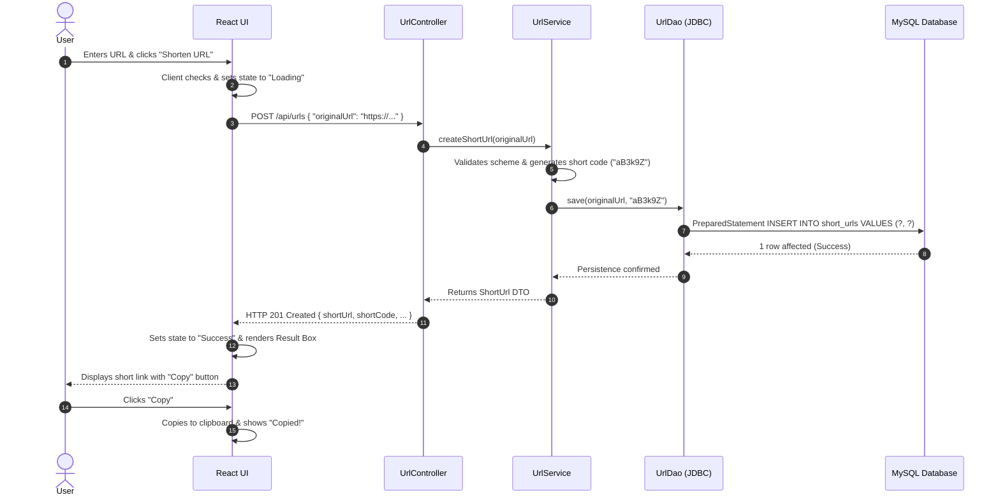
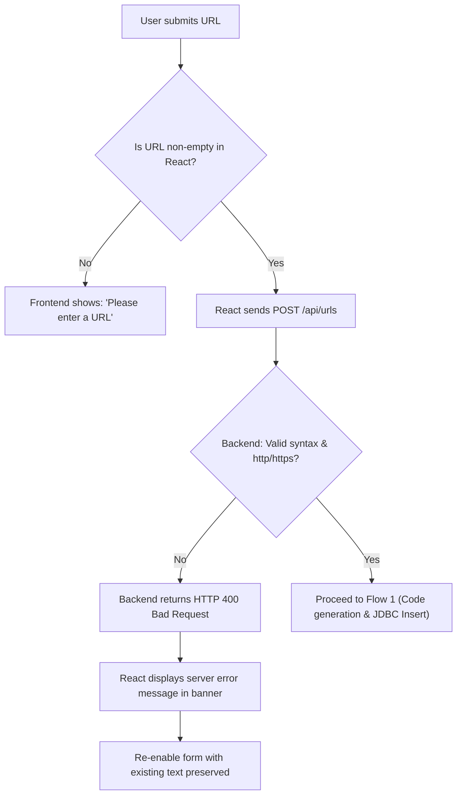
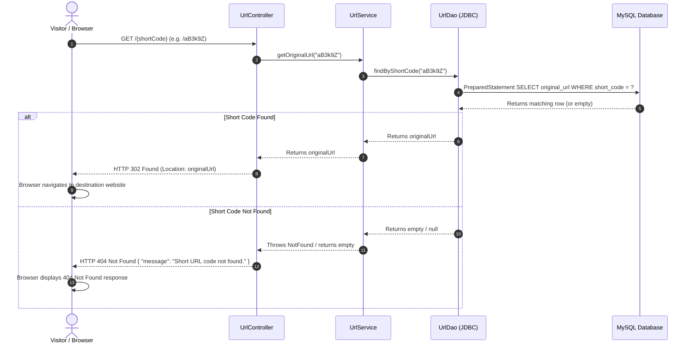
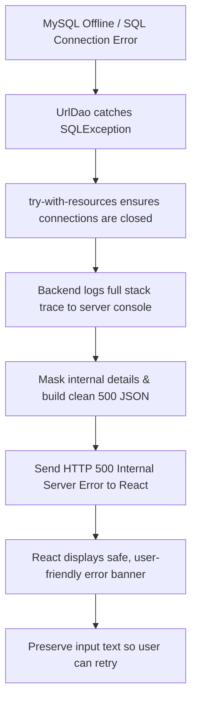

# Application Flow & User Journeys (FLOW.md)

## Project: URL Shortener (Backend Learning Project 1)

**Source of Truth Documents:**
- [PRD.md](file:///c:/Users/aksha/OneDrive/Desktop/Basic%20Project%20for%20backend/URL%20Shortner/Project%20Document%20File/PRD.md) — Core functional requirements and project scope
- [TRD.md](file:///c:/Users/aksha/OneDrive/Desktop/Basic%20Project%20for%20backend/URL%20Shortner/Project%20Document%20File/TRD.md) — Technical specifications, API payloads, and database schema
- [ARCHITECTURE.md](file:///c:/Users/aksha/OneDrive/Desktop/Basic%20Project%20for%20backend/URL%20Shortner/Project%20Document%20File/ARCHITECTURE.md) — Layered architecture and component responsibilities
- [UI_UX.md](file:///c:/Users/aksha/OneDrive/Desktop/Basic%20Project%20for%20backend/URL%20Shortner/Project%20Document%20File/UI_UX.md) — Visual design, layout, and component interaction states
- [PROJECT_RULES.md](file:///c:/Users/aksha/OneDrive/Desktop/Basic%20Project%20for%20backend/URL%20Shortner/Project%20Document%20File/PROJECT_RULES.md) — Development constraints and plain JDBC guidelines
- [TASKS.md](file:///c:/Users/aksha/OneDrive/Desktop/Basic%20Project%20for%20backend/URL%20Shortner/Project%20Document%20File/TASKS.md) — Phased implementation checklist and measurable completion tasks

---

## Overview

This document illustrates the step-by-step sequence of events across the application's five key user journeys:
1. Shortening a URL successfully
2. Submitting an invalid URL
3. Opening a short URL (redirection)
4. Handling storage or server failures
5. Frontend and backend API integration

For each flow, responsibilities are clearly divided among the **User**, **React Frontend**, **Spring Boot Backend**, **JDBC Data Access Layer**, and the **MySQL Database**.

---

## 1. Flow 1: Shorten a URL Successfully

This journey represents the primary "happy path" where a user submits a valid long URL and receives a working shortened URL with copy functionality.

### 1.1 Step-by-Step Sequence

1. **User Action:** The user types or pastes a long URL (e.g., `https://www.example.com/articles/backend-fundamentals`) into the input field and clicks the **"Shorten URL"** button (or presses `Enter`).
2. **Frontend Action (Pre-flight & State Update):**
   - Performs a quick client-side check to ensure the input is not empty and begins with `http://` or `https://`.
   - Clears any existing error messages.
   - Transitions UI state from `Idle` to `Loading`:
     - Disables the input field to prevent edits.
     - Disables the button and updates its label to `"Shortening..."`.
   - Sends an asynchronous HTTP request using Fetch API or Axios:
     - **Method:** `POST`
     - **URL:** `http://localhost:8080/api/urls`
     - **Headers:** `Content-Type: application/json`
     - **Body:** `{"originalUrl": "https://www.example.com/articles/backend-fundamentals"}`
3. **Backend Action (Controller & Service):**
   - `UrlController` intercepts the `POST /api/urls` request and deserializes the JSON body into a request DTO.
   - The controller passes `originalUrl` to `UrlService.createShortUrl(...)`.
   - `UrlService` runs formal server-side validation (ensuring valid URI syntax, non-blank input, and supported `http`/`https` protocol).
   - `UrlService` generates a unique 6-character alphanumeric short code (e.g., `aB3k9Z`) using a Base62 character pool (`[0-9, a-z, A-Z]`).
4. **JDBC / Database Action (DAO & MySQL):**
   - `UrlService` calls `UrlDao.save(originalUrl, shortCode)`.
   - `UrlDao` opens a connection from the `DataSource` using Java `try-with-resources`.
   - Prepares a parameterized SQL statement:
     ```sql
     INSERT INTO short_urls (original_url, short_code) VALUES (?, ?)
     ```
   - Binds the parameters safely using `preparedStatement.setString(1, originalUrl)` and `preparedStatement.setString(2, shortCode)`.
   - Executes the insert (`executeUpdate()`).
   - MySQL persists the row to the `short_urls` table, updates the unique index on `short_code`, and confirms row creation.
   - `try-with-resources` deterministically closes the `PreparedStatement` and releases the `Connection`.
5. **Backend Response:**
   - `UrlService` constructs the response payload containing `originalUrl`, `shortCode`, `shortUrl` (`http://localhost:8080/aB3k9Z`), and `createdAt`.
   - `UrlController` returns an HTTP `201 Created` status with the JSON response.
6. **Frontend Action (Result Display & Copy):**
   - React receives HTTP `201`, parses the JSON body, and transitions from `Loading` to `Success` state.
   - Re-enables the input field for future inputs.
   - Displays the result card showing the full shortened link (`http://localhost:8080/aB3k9Z`).
   - User clicks the **"Copy"** button:
     - React calls `navigator.clipboard.writeText("http://localhost:8080/aB3k9Z")`.
     - Button text changes from `"Copy"` to `"Copied!"` with green text feedback for 2 seconds, then resets to `"Copy"`.

### 1.2 Sequence Diagram



---

## 2. Flow 2: Submit an Invalid URL

This journey shows how errors are caught and surfaced when a user provides an empty string, an invalid format, or an unsupported protocol.

### 2.1 Two-Tier Validation Strategy

| Tier | Layer | Purpose | Checks Performed |
| :--- | :--- | :--- | :--- |
| **Tier 1** | React Frontend | Fast, immediate user feedback before network call | Empty/blank input, missing `http://` or `https://` prefix |
| **Tier 2** | Spring Boot Backend | Mandatory authoritative gatekeeper (never trust client) | Blank string check, URI syntax parsing, protocol whitelist (`http`/`https`), length $\le 2048$ chars |

### 2.2 Step-by-Step Sequence

1. **User Action:** The user enters an invalid URL (e.g., `not-a-valid-url` or `ftp://files.example.com`) or leaves the field empty and clicks **"Shorten URL"**.
2. **Path A — Caught by Frontend (Empty Input):**
   - If the input is empty or whitespace-only, React immediately stops submission.
   - Sets state to `Error` and renders an inline alert: *"Please enter a URL to shorten."*
   - Focus is returned to the input field without sending a network request.
3. **Path B — Caught by Backend (Malformed / Unsupported Scheme):**
   - If client-side validation is bypassed or allows a borderline string, React sends `POST /api/urls`.
   - `UrlController` receives the payload and passes it to `UrlService`.
   - `UrlService` evaluates the URL:
     - Detects missing/unsupported scheme (e.g., `ftp://` or `javascript:`).
     - Identifies that the string fails URI syntax parsing.
   - `UrlService` throws a validation exception (or returns an invalid result).
4. **Backend Response:**
   - Spring Boot catches the validation error (via Controller Advice or Controller logic).
   - Returns HTTP `400 Bad Request` with a clear, sanitized JSON body:
     ```json
     {
       "status": 400,
       "error": "Bad Request",
       "message": "Invalid URL format. URL must start with http:// or https://."
     }
     ```
5. **Frontend Error Display:**
   - React catches the HTTP 400 response.
   - Transitions state from `Loading` to `Error`.
   - Re-enables the input field and preserves the user's entered text so they can correct it.
   - Re-enables the submit button back to `"Shorten URL"`.
   - Displays a clean, red alert banner below the input showing the server's error message.

### 2.3 Flowchart



---

## 3. Flow 3: Open a Short URL (Redirection)

This journey explains what happens when a visitor opens a shortened link in a web browser.

### 3.1 Step-by-Step Sequence

1. **Visitor Action:** A user clicks a shortened link or types `http://localhost:8080/aB3k9Z` into their browser address bar.
2. **Browser Request:** The browser sends an HTTP `GET` request:
   - **Method:** `GET`
   - **Path:** `/aB3k9Z`
3. **Backend Processing:**
   - `UrlController` matches the path variable `shortCode = "aB3k9Z"`.
   - Calls `UrlService.getOriginalUrl("aB3k9Z")`.
   - `UrlService` delegates lookup to `UrlDao.findByShortCode("aB3k9Z")`.
4. **JDBC / Database Lookup:**
   - `UrlDao` opens a connection using `try-with-resources`.
   - Prepares parameterized query:
     ```sql
     SELECT original_url FROM short_urls WHERE short_code = ?
     ```
   - Sets parameter: `preparedStatement.setString(1, "aB3k9Z")`.
   - Executes query (`executeQuery()`) and inspects the `ResultSet`.
   - MySQL performs an index seek on the `UNIQUE INDEX idx_short_code`.
5. **Branching Outcomes:**

#### Path 3A: Short Code Exists (Success Redirection)
- The `ResultSet` contains a matching record.
- `UrlDao` extracts `original_url` (e.g., `https://www.example.com/articles/backend-fundamentals`).
- `UrlController` constructs a redirect response:
  - **HTTP Status:** `302 Found`
  - **Header:** `Location: https://www.example.com/articles/backend-fundamentals`
- The visitor's browser receives HTTP 302 and immediately navigates to the destination site.

#### Path 3B: Short Code Does Not Exist (Not Found)
- The `ResultSet` is empty (no record matches `"aB3k9Z"`).
- `UrlDao` returns an empty `Optional` (or `null`).
- `UrlService` signals that the code is unknown.
- `UrlController` returns:
  - **HTTP Status:** `404 Not Found`
  - **Body:**
    ```json
    {
      "status": 404,
      "error": "Not Found",
      "message": "Short URL code not found."
    }
    ```
- The browser displays the 404 error notification. *(Note: See section 5.3 regarding HTML vs JSON 404 view).*

### 3.2 Sequence Diagram



---

## 4. Flow 4: Handle a Storage or Server Error

This journey addresses unexpected failures such as database downtime, connection exhaustion, or query failures.

### 4.1 Safety and Information Masking Rules
- **Never expose technical internals:** Database table names, column names, raw SQL statements, and Java stack traces must **never** be sent to the user or browser.
- **Always log internally:** Full stack traces and error details must be logged to the Spring Boot server console for developer debugging.
- **Deterministic Cleanup:** All JDBC connections and statements must be closed safely via `try-with-resources` even if an exception occurs mid-execution.

### 4.2 Step-by-Step Sequence

1. **Trigger:** The user submits a valid URL, but MySQL is unreachable, the connection pool fails, or an unhandled exception occurs.
2. **JDBC Layer Handling:**
   - `UrlDao` catches a `SQLException`.
   - `try-with-resources` automatically closes any active statement or connection handles.
   - The exception is re-thrown as a clean custom runtime exception (e.g., `DatabaseOperationException`) or caught by Spring's exception handler.
3. **Backend Controller Response:**
   - Spring Boot logs the error internally: `logger.error("Database connection failure during save", e)`.
   - The backend constructs a sanitized error payload:
     - **HTTP Status:** `500 Internal Server Error`
     - **Body:**
       ```json
       {
         "status": 500,
         "error": "Internal Server Error",
         "message": "An error occurred while creating the short URL. Please try again later."
       }
       ```
4. **Frontend Action:**
   - React catches the HTTP 500 status.
   - Transitions state from `Loading` to `Error`.
   - Re-enables the form with the user's submitted text preserved.
   - Displays a clean error banner: *"Unable to connect to the server. Please check your connection and try again."*

### 4.3 Error Flowchart



---

## 5. Frontend and Backend Integration

### 5.1 Communication Specifications

- **Protocol:** HTTP / 1.1 REST API with JSON payloads.
- **Frontend Host:** `http://localhost:5173` (Vite development server default).
- **Backend Host:** `http://localhost:8080` (Spring Boot embedded Tomcat default).
- **CORS Policy:** Spring Boot allows requests from origin `http://localhost:5173`.
- **Build Sequence Alignment:** Development adheres to the agreed sequence:
  $$\text{Documentation / Planning} \longrightarrow \text{Frontend} \longrightarrow \text{Backend} \longrightarrow \text{Database Setup / Connectivity} \longrightarrow \text{API Testing} \longrightarrow \text{Frontend / Backend Integration}$$
  *(See [ARCHITECTURE.md Section 7](file:///c:/Users/aksha/OneDrive/Desktop/Basic%20Project%20for%20backend/URL%20Shortner/Project%20Document%20File/ARCHITECTURE.md#7-verified--planned-project-structure) for verified baseline and planned directory tree).*

### 5.2 API Contract Summary (from TRD.md)

#### Endpoint 1: Create Short URL
- **Path:** `POST /api/urls`
- **Headers:** `Content-Type: application/json`
- **Request Body:**
  ```json
  {
    "originalUrl": "https://www.example.com/some/long/link"
  }
  ```
- **Success Response (`201 Created`):**
  ```json
  {
    "originalUrl": "https://www.example.com/some/long/link",
    "shortCode": "aB3k9Z",
    "shortUrl": "http://localhost:8080/aB3k9Z",
    "createdAt": "2026-10-21T18:00:00Z"
  }
  ```
- **Client Error (`400 Bad Request`):**
  ```json
  {
    "status": 400,
    "error": "Bad Request",
    "message": "Invalid URL format. URL must start with http:// or https://."
  }
  ```

#### Endpoint 2: Redirect Short URL
- **Path:** `GET /{shortCode}`
- **Success Response (`302 Found`):**
  - Header: `Location: <originalUrl>`
  - Body: *Empty*
- **Not Found Error (`404 Not Found`):**
  ```json
  {
    "status": 404,
    "error": "Not Found",
    "message": "Short URL code not found."
  }
  ```

---

### 5.3 Flow Details to Be Confirmed

The following implementation nuances are not explicitly finalized in the foundational documents and are marked as **to be confirmed** before implementation:

1. **404 View for Browser Visitors:**
   - *Status:* **To be confirmed**
   - *Detail:* If a regular user enters a non-existent short URL directly into a browser address bar, `GET /{shortCode}` currently returns a JSON payload (`{"status": 404, "message": "..."}`). We should confirm whether returning a simple, styled HTML error page or standard JSON response is preferred for direct browser visitors.
2. **Dynamic Base URL Resolution:**
   - *Status:* **To be confirmed**
   - *Detail:* In `UrlResponse`, `shortUrl` is currently modeled with `http://localhost:8080/` as the default prefix. We should confirm whether this should be hardcoded in `application.properties` (e.g. `app.base-url=http://localhost:8080`) or derived dynamically from `HttpServletRequest`.
3. **Duplicate Code Collision Retry Limit:**
   - *Status:* **To be confirmed**
   - *Detail:* TRD.md recommends a retry limit of 3 to 5 attempts upon encountering a duplicate short code key violation before returning an error. The exact number (e.g., 3 retries) can be finalized during the Service layer implementation.
